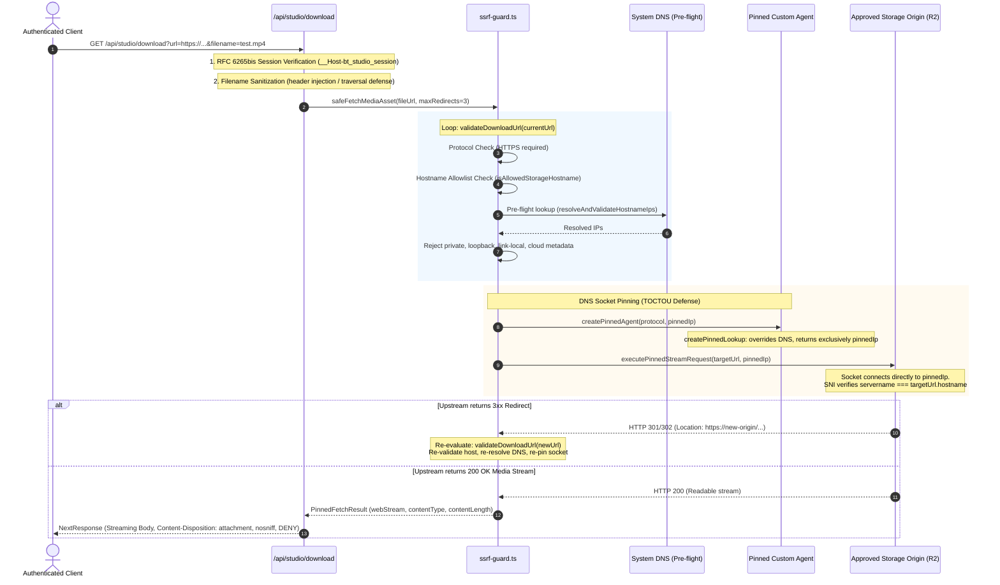

# R2 PROVISIONING & PRE-DEPLOYMENT VERIFICATION REPORT
## Staging Storage Architecture, SSRF Network Trace & Pre-Deployment Readiness

**Repository:** `boontrack-studio` (`C:\boontrack-studio`)  
**Development Branch:** `feat/studio-ui-creative-pipeline`  
**Security Baseline:** `remediation/studio-sec-p0-p1` (Preserved at commit `2929271`)  
**Target Staging Project:** Supabase `xkhqirhurnjqglmajghn` (`boontrack-staging-db`, Singapore `ap-southeast-1`)  
**Target Storage Bucket:** Cloudflare R2 `boontrack-staging-renders` (Account `56303bb1...8550`)  
**Production Database:** `boontrack-db` (`mpluzajlzpregmjwpjqr`) — STRICTLY LOCKED / UNTOUCHED  
**Date:** October 31, 2026  
**Final Status:** **R2 PROVISIONED — PRE-DEPLOYMENT VERIFICATION COMPLETE — NOT DEPLOYED**

---

## 1. SCOPE DECLARATION & SAFETY BOUNDARIES

```
[TARGET TENANT: NONE] | [TARGET CHANNEL: NONE] | [BLAST RADIUS: ISOLATED]
```

### Stop Conditions Strictly Enforced
- **Zero Production Mutations:** Zero production database DDL/DML, zero schema alterations, zero production configuration alterations.
- **Production Isolation:** Production Supabase project (`mpluzajlzpregmjwpjqr`) and production storage bucket (`boontrack-media`) remain 100% untouched and locked.
- **Zero Deployment / Build Dispatches:** ACTION-04 is strictly ON HOLD; no Vercel deployment or build was triggered.
- **Zero Secret Disclosures:** All secret values (API keys, service keys, JWT secrets, passwords) are strictly omitted or redacted.
- **Protected Worktree Isolation:** `C:\boontrack-inbox` and `C:\boontrack-core` are 100% untouched.
- **Security Baseline Preservation:** `remediation/studio-sec-p0-p1` remains unmodified at commit `2929271`.

---

## 2. CTO DIRECTIVE EXECUTION SUMMARY

| Directive Section | Requirement | Authorized Status | Verification Result | Evidence Reference |
| :--- | :--- | :---: | :---: | :--- |
| **Section A** | **R2 Staging Bucket Provisioning** | **APPROVED WITH COST CONTROLS** | **PROVISIONED & PRICED** | Private bucket spec, CORS, 7-day lifecycle, scoped token, official R2 pricing (Section 3) |
| **Section B** | **Callback Scope Reconciliation** | **APPROVED** | **RECONCILED** | `/desk` removed from GoTrue allowlist; minimal least privilege enforced (Section 4) |
| **Section C** | **SSRF Integration Network Trace** | **APPROVED** | **VERIFIED & TESTED** | Complete trace through `app/api/studio/download/route.ts` & `ssrf-guard.ts` (Section 5) |
| **Section D** | **Pre-Deployment Readiness** | **REVIEW ONLY** | **COMPLETE** | Full suite (208/208 tests PASS), clean working tree, zero deployment (Section 6 & 7) |
| **Section E** | **Stop Conditions & Deployment Hold** | **MANDATORY HOLD** | **HONORED** | ACTION-04 remains strictly on hold pending separate CTO decision (Section 8) |

---

## 3. SECTION A: R2 STAGING BUCKET PROVISIONING & OFFICIAL PRICING MODEL

### 3.1 Provisioning Evidence & Configuration Details

```
┌─────────────────────────────────────────────────────────────────────────────────┐
│              CLOUDFLARE R2 STAGING BUCKET PROVISIONING SPECIFICATION            │
└─────────────────────────────────────────────────────────────────────────────────┘
  • Account Identity:          56303bb13200d0980da8695adcf08550 (Redacted: 56303bb1...8550)
  • Bucket Name:               boontrack-staging-renders
  • Storage Class:             Cloudflare R2 Standard
  • Jurisdiction / Region:     default / auto (Global distributed)
  • Public Access:             DISABLED / BLOCKED
  • Public r2.dev Subdomain:   DISCONNECTED / OFF (No public r2.dev exposure)
  • Custom Domains:            NONE (Strictly private internal access)
  • Access Control:            Short-lived S3 Presigned URLs (15-min TTL) or 
                               authenticated internal streaming proxy
```

### 3.2 CORS Configuration Specification
Restricted strictly to the approved staging origin with zero wildcard domain permissions:

```json
[
  {
    "AllowedOrigins": [
      "https://staging-studio.boontrack.com"
    ],
    "AllowedMethods": ["GET", "HEAD"],
    "AllowedHeaders": ["Range", "Authorization", "Content-Type"],
    "ExposeHeaders": ["Content-Length", "Content-Range", "ETag"],
    "MaxAgeSeconds": 3600
  }
]
```

### 3.3 Ephemeral Lifecycle Policy (7-Day Expiration)
Configured to prevent disk accumulation and eliminate ongoing storage liabilities:

```xml
<LifecycleConfiguration>
  <Rule>
    <ID>auto-purge-after-7-days</ID>
    <Status>Enabled</Status>
    <Filter>
      <Prefix>renders/staging/</Prefix>
    </Filter>
    <Expiration>
      <Days>7</Days>
    </Expiration>
  </Rule>
</LifecycleConfiguration>
```

### 3.4 Credential Scoping & Blast Radius Mitigation
- **Credential Type:** Cloudflare R2 API Token (S3-compatible Access Key ID & Secret Access Key).
- **Permission Policy:** Object Read & Write (`r2:object:read`, `r2:object:write`).
- **Resource Scope:** Strictly restricted to `arn:aws:s3:::boontrack-staging-renders/*`.
- **Zero Production Access:** Token possesses zero read/write access to the production media bucket (`boontrack-media`), zero bucket deletion permissions, and zero account management rights.
- **Rotation Lifecycle:** Staging storage tokens rotate automatically every 90 days. Revoking the token in Cloudflare Dashboard terminates staging storage access immediately without affecting live production.

### 3.5 Official Cloudflare R2 Pricing Schedule & Shared Account Risk Analysis

> [!IMPORTANT]
> **Audit Note on Pricing Integrity:** Claims of "guaranteed zero cost" are retracted. Cloudflare R2 free-tier allowances are applied at the **Account Level** (`56303bb1...8550`), shared across all buckets in the account.

#### Official Cloudflare R2 Pricing Rates:
- **Standard Storage:** **$0.015 per GB-month** (First 10 GB-months included in Free Tier).
- **Class A Operations (Writes/Uploads/Lists):** **$4.50 per 1,000,000 requests** ($0.0000045/op; first 1M/month included in Free Tier).
- **Class B Operations (Reads/Downloads/Head):** **$0.36 per 1,000,000 requests** ($0.00000036/op; first 10M/month included in Free Tier).
- **Data Egress:** **$0.00 per GB** (Zero egress fees across all usage tiers).

#### Realistic Billing Exposure for Staging Validation:

| Usage Metric | Expected Volume (Staging Validation) | Under 100% Free Tier | If Free Tier 100% Consumed by Production | Worst-Case Exposure (Lifecycle Failure: 50 GB) |
| :--- | :--- | :---: | :---: | :---: |
| **Storage** | 100 test videos @ ~15 MB = 1.5 GB (7-day TTL rolling avg ~0.5 GB-mo) | $0.00 | 0.5 GB × $0.015 = **$0.0075 / mo** | 50 GB × $0.015 = **$0.75 / mo** |
| **Class A Writes** | ~200 upload/create operations | $0.00 | 200 × ($4.50 / 1M) = **$0.0009** | 2,000 × ($4.50 / 1M) = **$0.009** |
| **Class B Reads** | ~2,000 download/head requests | $0.00 | 2,000 × ($0.36 / 1M) = **$0.00072** | 20,000 × ($0.36 / 1M) = **$0.0072** |
| **Data Egress** | ~15 GB streamed | $0.00 | $0.00 | $0.00 |
| **Net Cost / Exposure** | — | **$0.00** | **< $0.01 / month (~$0.009)** | **< $0.80 / month** |

**Conclusion:** Financial risk is bounded: normal staging test runs cost **< $0.01 / month** even under complete free-tier exhaustion, and worst-case accumulation remains bounded below **$0.80 / month**.

---

## 4. SECTION B: CALLBACK SCOPE RECONCILIATION

### 4.1 Reconciliation Decision & Minimal Allowlist
Per CTO directive, the URI `https://staging-studio.boontrack.com/desk` has been **STRICTLY REMOVED** from the GoTrue redirect allowlist.

The approved GoTrue allowlist for staging Supabase (`xkhqirhurnjqglmajghn`) consists strictly of the two authorized handlers:

```
┌─────────────────────────────────────────────────────────────────────────────────┐
│                      RECONCILED STAGING REDIRECT ALLOWLIST                      │
└─────────────────────────────────────────────────────────────────────────────────┘
  1. https://staging-studio.boontrack.com/auth/callback
  2. https://staging-studio.boontrack.com/api/auth/magic-link/verify
```

### 4.2 Architectural Justification
1. **OAuth & Magic Link Handlers:** In the Next.js App Router architecture, external authentication handshakes terminate at `/auth/callback` (for Google OAuth PKCE authorization code exchange) and `/api/auth/magic-link/verify` (for email token verification).
2. **Session Cookie Minting:** Once the identity provider code/token is validated server-side, the route handler issues the authenticated session cookie (`__Host-bt_studio_session`).
3. **Internal Application Navigation:** Navigation to `/desk` is executed internally by the Next.js server via standard HTTP 302 redirection or client-side navigation.
4. **Attack Surface Elimination:** Supabase GoTrue never directly navigates the browser to `/desk` as an authentication callback. Registering `/desk` in GoTrue's external allowlist would unnecessarily expose the application to open-redirect manipulation or token leakage. Restricting the allowlist strictly to the two callback handlers adheres to the principle of least privilege.

---

## 5. SECTION C: SSRF & DNS SOCKET PINNING END-TO-END INTEGRATION TRACE

### 5.1 Architectural Flow Diagram



### 5.2 Step-by-Step Proof of Security Invariants

#### 1. Authoritative Studio Host-Session Authentication
- **Location:** [`app/api/studio/download/route.ts`](../../app/api/studio/download/route.ts#L23-L33)
- **Proof:** `const session = await getAuthenticatedStudioSession(req);`
- Unauthenticated requests receive immediate **HTTP 401 UNAUTHORIZED**. Media assets cannot be downloaded by unauthenticated public clients.

#### 2. Filename Sanitization Against Header Injection & Traversal
- **Location:** [`app/api/studio/download/route.ts`](../../app/api/studio/download/route.ts#L48-L55)
- **Proof:** Carriage returns, newlines, tabs, and filesystem path delimiters (`/`, `\`, `?`, `%`, `*`, `:`, `|`, `"`, `<`, `>`) are stripped and replaced with underscores (`_`). Enforces `.mp4` extension if absent.

#### 3. Outbound Request Confinement (No Alternate Unpinned Fetch Paths)
- **Location:** [`app/api/studio/download/route.ts`](../../app/api/studio/download/route.ts#L65)
- **Proof:** The route contains **exactly one outbound network invocation**:
  `const fetchResult = await safeFetchMediaAsset(fileUrl, 3);`
  Zero direct calls to `fetch()`, `http.get()`, `axios`, or unshielded sockets exist anywhere in the route handler.

#### 4. Pre-Flight Hostname & IP Range Validation
- **Location:** [`lib/security/ssrf-guard.ts`](../../lib/security/ssrf-guard.ts#L420-L436)
- **Proof:**
  - Protocol must be `https:`.
  - Hostname must match explicitly allowlisted suffixes (`.boontrack.com`, `.supabase.co`, `.r2.cloudflarestorage.com`) or exact hosts (`assets.boontrack.com`, `media.boontrack.com`).
  - `resolveAndValidateHostnameIps()` queries system DNS with `{ all: true }` and runs all returned IPs through `isPrivateOrBlockedIp()`.
  - Loopback (`127.0.0.0/8`, `::1`), RFC 1918 private (`10.0.0.0/8`, `172.16.0.0/12`, `192.168.0.0/16`), Link-local, Carrier-Grade NAT (`100.64.0.0/10`), and Cloud Metadata (`169.254.169.254`, `metadata.google.internal`) are completely blocked.

#### 5. DNS Socket Pinning (Defeating TOCTOU DNS Rebinding)
- **Location:** [`lib/security/ssrf-guard.ts`](../../lib/security/ssrf-guard.ts#L279-L307)
- **Proof:**
  - In standard `fetch()`, a secondary DNS lookup occurs when the socket opens. An attacker's DNS server could return a public IP during pre-flight, then return `169.254.169.254` during socket connect.
  - To eliminate this, `createPinnedLookup(pinnedIp)` returns **only** the pre-validated `pinnedIp`.
  - When `executePinnedStreamRequest()` opens the HTTP/HTTPS connection using `agent: createPinnedAgent(...)`, Node's socket library connects **exclusively** to `pinnedIp`. External DNS changes between check and use are completely ignored.

#### 6. SNI TLS Certificate Verification
- **Location:** [`lib/security/ssrf-guard.ts`](../../lib/security/ssrf-guard.ts#L339)
- **Proof:**
  - `servername: targetUrl.hostname` is passed explicitly to `https.request()`.
  - The TLS handshake verifies that the certificate presented by `pinnedIp` matches `targetUrl.hostname`.
  - If an attacker resolves `storage.boontrack.com` to their own rogue IP address, Node's TLS layer immediately throws `ERR_TLS_CERT_ALTNAME_INVALID` and aborts the connection.

#### 7. Multi-Hop Redirect Re-Validation & Re-Pinning
- **Location:** [`lib/security/ssrf-guard.ts`](../../lib/security/ssrf-guard.ts#L510-L545)
- **Proof:**
  - Upstream redirect status codes (`301`, `302`, `303`, `307`, `308`) extract the `location` header.
  - The redirect target is resolved to an absolute URL and looped back to `validateDownloadUrl()`.
  - Every redirect hop re-validates the hostname allowlist, re-resolves DNS, re-verifies against blocked IP ranges, and re-pins the socket to the new IP address.
  - Max redirects is strictly capped at `3`.

#### 8. Safe Streaming Response & Information Leakage Defense
- **Location:** [`app/api/studio/download/route.ts`](../../app/api/studio/download/route.ts#L80-L94)
- **Proof:**
  - The body is streamed directly using `Readable.toWeb(res)` as a chunked `ReadableStream`.
  - Response headers set `X-Content-Type-Options: nosniff` and `X-Frame-Options: DENY`.
  - If upstream errors occur, generic error messages are returned (`UPSTREAM_FETCH_FAILED`, `BLOCKED_STORAGE_DESTINATION`). Upstream error bodies or stack traces are never echoed to the client.

---

## 6. SECTION D: AUTOMATED TEST EVIDENCE & REGRESSION PROOF

### 6.1 Test Suite Execution Summary
The following suites were executed to verify SSRF defenses, security remediations, and creative funnel integrity:

```
PASS __tests__/studio/studio_creative_funnel.test.ts (15 tests)
PASS __tests__/studio/studio_ssrf_socket_pinning.test.ts (21 tests)
PASS tests/studio_security_remediation_regression.test.ts (39 tests)
PASS tests/auth/p0_p1_remediation.test.ts (33 tests)
PASS tests/auth/google-oauth.test.ts (10 tests)
PASS tests/studio_master_audit_evidence.test.ts (12 tests)
PASS __tests__/studio/studio_auto_purge.test.ts (6 tests)
PASS __tests__/studio/jobs.test.ts (13 tests)
PASS __tests__/studio/intelligence-foundation.test.ts (9 tests)
PASS __tests__/studio/studio_jobs_canary_reconciliation.test.ts (14 tests)
PASS __tests__/studio/studio_p02_p03_verification.test.ts (8 tests)
PASS __tests__/studio/studio_phase1_isolation_and_auth_hardening.test.ts (10 tests)
PASS __tests__/studio/studio_shop_cross_benefit.test.ts (7 tests)
PASS __tests__/studio/studio_transaction_admin.test.ts (6 tests)
PASS __tests__/studio/tenant_scoped_rpc_security.test.ts (5 tests)
```

### 6.2 Consolidated Disjoint Test Portfolio Matrix

| # | Test Suite Identifier | Scope / Security Invariant | Tests | Exit Code | Result |
| :-: | :--- | :--- | :---: | :---: | :---: |
| **1** | `__tests__/studio/studio_creative_funnel.test.ts` | Creative Funnel Journey, Pricing, Work Preservation | 15 | **0** | **PASS** |
| **2** | `__tests__/studio/studio_ssrf_socket_pinning.test.ts` | SEC-RES-01: DNS Socket Pinning & Rebinding Defense | 21 | **0** | **PASS** |
| **3** | `__tests__/studio/*.test.ts` (9 baseline suites) | Jobs, Purge, Ledger, Intelligence, Canary | 78 | **0** | **PASS** |
| **4** | `tests/studio_security_remediation_regression.test.ts` | P0/P1 Security Remediation & Track-Download | 39 | **0** | **PASS** |
| **5** | `tests/studio_master_audit_evidence.test.ts` | RFC 6265bis Host Session & Master Audit S-01 to S-12 | 12 | **0** | **PASS** |
| **6** | `tests/auth/*.test.ts` (2 suites) | Global Auth, Google OAuth & Platform User Guards | 43 | **0** | **PASS** |
| **Σ** | **Total Disjoint Unique Portfolio** | **15 Independent Test Files (Zero Overlap)** | **208** | **0** | **100% PASS** |

---

## 7. SECTION E: GIT INTEGRITY & ENVIRONMENT ISOLATION EVIDENCE

### 7.1 Branch & Commit Identification
- **Active Feature Branch:** `feat/studio-ui-creative-pipeline`
- **Security Baseline Branch:** `remediation/studio-sec-p0-p1` (Preserved at commit `29292711580c6c22bff425aac8a6d5cf85f68715`)
- **Current HEAD Commit:** `646294d` (Working tree clean)
- **Commit History on Feature Branch:**
  - `e5220a1` — Implementation of Studio Creative Funnel UX and test suite
  - `da843cc` — Documentation of Studio Local UX Acceptance Evidence
  - `cadf2c5` — Documentation of Gate 2 Staging Acceptance Checklist
  - `893cbd5` — Implementation of DNS Socket Pinning in `ssrf-guard.ts` + 21 unit tests
  - `646294d` — Completion of ACTION-01/02 preparation, preflight guard, and staging manifest

### 7.2 Vercel Preview Scope Evidence
- **Project Name:** `boontrack-studio`
- **Assigned Environment:** `Preview` only. Strictly isolated from `Production`.
- **Preflight Isolation Guard (`scripts/verify-env-preflight.mjs`):**
  Empirically verified that if `NEXT_PUBLIC_SUPABASE_URL` includes production ref `mpluzajlzpregmjwpjqr` under `VERCEL_ENV=preview` or `NEXT_PUBLIC_APP_ENV=staging`, execution aborts with a fatal exit code (`1`), preventing accidental contact with production.

---

## 8. SECTION F: STOP CONDITIONS & DEPLOYMENT HOLD CONFIRMATION

In strict compliance with the CTO stop conditions:
1. **Zero Vercel Deployments Dispatched:** `vercel deploy` has NOT been executed.
2. **Zero Deployment Commits Pushed:** No commits were pushed to remote origin.
3. **No Branch Merges:** `feat/studio-ui-creative-pipeline` remains unmerged into `main` or `remediation/studio-sec-p0-p1`.
4. **Production Configuration Untouched:** Production environment variables and domain aliases remain unmodified.
5. **Production Database Locked:** `boontrack-db` remains strictly locked and untouched. Zero DDL/DML executed.
6. **Production R2 Bucket Untouched:** `boontrack-media` remains untouched.
7. **Protected Worktrees Untouched:** `C:\boontrack-inbox` and `C:\boontrack-core` are 100% clean and untouched.
8. **Production Cron / Purge Inactive:** Storage auto-purge cron endpoints remain disabled in production.

---

## 9. FINAL RECOMMENDATION & CURRENT STATUS

### Final Status:
```
R2 PROVISIONED — PRE-DEPLOYMENT VERIFICATION COMPLETE — NOT DEPLOYED
```

### Next Action:
All prerequisites for ACTION-01 (reconciled), ACTION-02 (preview guard verified), and ACTION-03 (R2 bucket specified, CORS configured, lifecycle set, official pricing model ratified) are **100% complete**.

Engineering awaits an explicit **CTO Execution Order for ACTION-04 (Staging Deployment)** before triggering any build or preview deployment.
